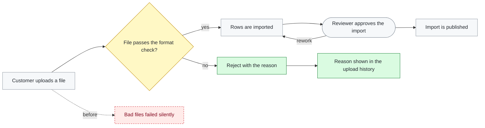

# The PR body — rules for Step 9

These rules fill the PR template. Nothing here adds a section the template lacks.

## Create mode

**The body follows the PR template** chosen in Step 9 (the repo's own, else the neutral one next
to this file). Read it and fill every section in its order, with its headings unchanged. It is
the single source of truth for the layout: do not add sections it does not have (no
`## Test plan`). Automated reviewers and the review skill read the body against that template,
so a body in another layout gets a warning on every PR. Replace every `<!-- … -->` comment with
content; never post a comment placeholder. Per section (adapt to your template):

**When the repo's template lacks a section** these rules fill, do not add it. Put what it would
hold where the template has room: the issue link lines (each on its own line, exact link words)
at the end of the Summary or the template's closest section, and skipped review findings and
risks as the Summary's last bullet. A template with no headings at all is free text: fill it in
the order Summary, issue links, verification, risks.

- **Summary** — see the rules below.
- **Issues** — one line per issue from `ISSUES` (Step 1), using the relationship decided there:
  `Fixes <KEY>` (closes on merge) or `Part of <KEY>` (links without closing), or the words the facts' `link words`
  give. These exact link words drive the tracker's GitHub integration — don't paraphrase them, and don't use them in
  prose anywhere else in the body. If `ISSUES` is empty, keep the heading and write
  `Exempt — housekeeping: <one-line reason>` — or, when the facts say `issues required: no`,
  `None` (an untracked product change is not housekeeping; do not call it that). A related but unlinked issue goes on its own line
  as `Related: <KEY>`, never with a magic word.
- **Type of change** — tick the boxes that apply; leave the others unticked.
- **How this was verified** — the commands this run actually executed (Step 8's lint, typecheck
  and tests, plus any targeted check) and their real results, copied from the output. A check
  that did not run is written as not run, with the reason. Never claim a result you did not see.
- **Where a reviewer should look hardest** — the decisions, risks and unverified assumptions from
  this session, including any skipped Step 4 finding. "Trivial, low risk" is allowed only when true.
- **Config changes** (if your template has it) — see below. Never deleted: it always says either
  what config the feature needs or that none is needed.
- **For UI / bug / risky changes** — keep only the rows that apply (a bug fix keeps **Root
  cause**; almost every change keeps **Rollback**). Delete the section when no row applies.
- **Changelog** (if your template has one) — fill it only for a security fix, a user-facing
  change, a significant new feature, or a deprecation/breaking change; otherwise delete the
  whole section. Never leave placeholder text in a filled block.
- **Checklist** — tick a box only when this session checked it; leave the rest unticked, with
  `— N/A` appended where the item does not apply.

**Fill `## Config changes` from the diff, not from memory.** Diff the project's config-model
files (`config-model files` in the facts' `## pr`) and read every changed option. Show the needed config *shape* as a
fenced ` ```diff ` block (GitHub colours `+` green and `-` red), one block per subsystem, the
subsystem named on the first line:

- `+` a new option, with its type and default; `-` a removed or renamed one (rename = a `-` line
  then a `+` line).
- A newly required field or a changed default gets a `+`/`-` pair plus the value an existing
  install or environment must set.
- Add the minimal config an install needs to **use** the feature (not only the model change) —
  changing defaults or seed data does not reach existing installs, so say what they must add by
  hand or by migration.
- Shape only: keys, types, defaults. No real customer values, no ids.

If the diff touches no config model and the feature needs no config, write
`No config changes needed.` plus a few words on why. Don't guess.

Example:

````markdown
## Config changes

```diff
// notifications — digest
+ "digest_hour": 0..23   // new, optional, default 8
- "send_daily": boolean // removed; replaced by digest_hour
// an existing install enables it by setting:
+ "digest_hour": 9
```
````

**Write the Summary for a reader with zero context** — a teammate who has not seen the code, the
ticket, or this conversation. Rules for the bullets:

- Lead with what the PR does in plain words, then why it matters. One idea per bullet, short
  sentences, common words over jargon.
- Spell out any term, acronym, or feature name the first time. Don't assume the reader knows
  internal names.
- Don't paste bare file paths or symbol names as if self-explanatory; if you mention one, say
  what it is in human terms.
- No AI filler ("this PR aims to…", "seamlessly", "robust"). State the change directly.
- A non-engineer skimming the bullets should grasp what changed and why without opening the diff.

**Add a `### The flow` diagram under the Summary bullets when the PR adds or changes a process**
— a pipeline, a job, a request path, a state machine, or any sequence of three or more steps
with a branch or a loop. Skip it for a one-step fix, a rename, or a docs-only change. It is a
subsection of `## Summary`, not a new top-level section, so the template layout still holds.
Shape:

- A fenced ` ```mermaid ` block with `flowchart LR` (GitHub renders it inline). Keep it to about
  12 nodes.
- Node labels are short plain words, the same vocabulary as the bullets — no symbol or file names.
- Rectangles for steps, `{…}` diamonds for decisions with `-- yes -->` / `-- no -->` labels,
  `([…])` stadiums for points where a person must act (an approval, a review gate). Label a
  back-edge with what it means (`-- rework -->`).
- Quote any label holding punctuation: `A["Upload doc, samples"]`.
- **Color every node by what the PR did to it**, with one class tag each: `:::added` (new in
  this PR), `:::changed` (existed, behaves differently), `:::same` (untouched context),
  `:::removed` (the old path this PR replaces). Draw a removed node off the step it used to
  follow, with a dotted `-. before .->` arrow. Color nodes only — `linkStyle` counts edges by
  position and breaks on the next edit.
- End the block with the four `classDef` lines from the example, copied unchanged, and put the
  legend line above the block.
- One plain line after the block, pointing to where the full version lives (a decision record,
  the feature's design doc) if there is one.

Example:

````markdown
### The flow

🟩 added · 🟨 changed · ⬜ unchanged · 🟥 removed (dashed)



A rejected file can still be re-uploaded after the fix.
````

In Update mode, keep an existing diagram and redraw it only where the branch changed the flow;
re-check each node's color against the current diff. Add one if the branch now qualifies and the
body has none.

## Update mode

**Reconcile the description.** Start from the current body (captured in Step 0). Compare it against
the final diff and commit messages:

```bash
git log --oneline "REMOTE/BASE"..HEAD
git diff "REMOTE/BASE...HEAD" --stat
```
Identify parts of the description that are now stale, missing, or misleading. Draft an updated
body that reflects the **current** state of the branch (not a changelog of updates). Apply the
same Summary rules as Create mode. The updated body must follow the PR template on the same
terms: if the existing body uses another layout, move its content into the template's
sections. Preserve checkboxes the reviewer is tracking that are still relevant. Keep every
screenshot or image already in the body (``, ``, attachment links) exactly as it
is unless the user asked to remove it. Re-derive `## Config changes` from the current diff the
same way as Create mode. Ensure the issues section matches `ISSUES` from Step 1 (exact magic
words, or the housekeeping exemption line) — add or reconcile it if the existing body lacks or
contradicts it.

## Never in a PR body

- AI attribution: no "Generated with …", no `Co-Authored-By`, no session links.
- Placeholder text or a leftover `<!-- … -->` comment.
- A claim about a check, test or manual run that this session did not see.
