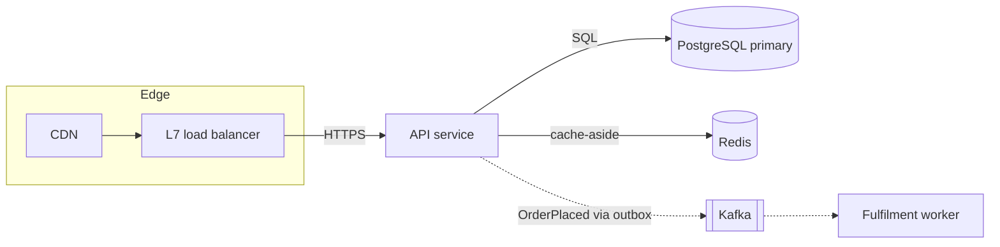

# Output templates

## Contents
- [Design document](#design-document)
- [Trade-off table](#trade-off-table)
- [ADR](#adr)
- [Mermaid diagrams](#mermaid-diagrams)
- [HTML+SVG diagram (--html)](#htmlsvg-diagram---html)
- [Review report](#review-report)

## Design document
Path: `docs/design/<slug>.md` (or where the project keeps design docs). Headings below are
what `check_design.py` looks for; keep them.

```markdown
# <System name> - design

Status: draft | reviewed | accepted · Date: YYYY-MM-DD · Owner: <team>

## Summary
Three to five sentences: the problem, the decision, the main trade-off.

## Requirements
### Functional requirements
### Non-functional requirements
(each with a number and a condition; mark given vs assumed)
### Non-goals

## Estimation
Calculator command (with `--out docs/design/<slug>.calc.json`, saved next to this doc) and the
figures that matter; each input labelled given or assumed; triggers that fired; the
sensitivity band.

## Architecture
Mermaid diagram; components and what each owns; request paths for the top use cases.

## API and data model
Core endpoints/messages; entities, keys, indexes, partitioning; concurrency control.

## Deep dives
### <Hardest problem 1>
### <Hardest problem 2>

## Consistency and failure modes
Per data type: consistency model and what users see. At least one cascade walked end to end,
degradation modes, DR tier with RPO/RTO.

## Security, operations and cost
Trust boundaries and top threats; tenancy; data lifecycle; observability; rollout; cost estimate.

## Trade-offs
(the table)

## Evolution
10x and 100x from the calculator's `--scale 10,100` run (quote what fires at each factor),
each step with its trigger; migration plan if brownfield.

## Open questions
Assumptions that most change the design, and who can answer them.

## Review log
Reviewer and agy findings, each accepted or rejected, and why. Say whether agy ran, was
skipped or failed (with its code). A review done without a subagent is labelled
"self-review (no independent reviewer available)".
```

## Trade-off table
```markdown
| Decision | Solves | Worsens | Change it when |
|---|---|---|---|
| PostgreSQL primary + 2 read replicas | ACID orders, simple ops for a 6-person team | single write node; replica lag on reads | peak writes > 8k/s for 15 min, or replica lag p99 > 2 s |
| Redis cache-aside for product pages | 90% of reads off the DB | stale prices up to 60 s | price-change complaints > 5/week, or hit ratio < 80% |
| Stock in sub-counters (16 per hot SKU) | flash-sale contention on one row | sum-on-read; harder audits | a SKU's buy rate < 50/s (collapse back) |
```
Each "Change it when" has a number and a comparison and is consistent with the Estimation
section. A trigger far beyond any plausible load is a strawman - pick one you would actually
watch.

## ADR
Path: `docs/adr/NNNN-<slug>.md`, next free number. Never edit an accepted ADR; write a new one
that supersedes it and links to it. The only change allowed in the old ADR is its Status line
(`superseded by NNNN`).

```markdown
# NNNN. <Decision title>

Status: proposed | accepted | superseded by NNNN · Date: YYYY-MM-DD

## Context
The forces: requirements, numbers, constraints.

## Decision
What we do, in one paragraph.

## Alternatives considered
Each with why it lost.

## Consequences
What gets better, what gets worse, what we must now watch.

Change it when: <observable trigger with a number>.
```

## Mermaid diagrams
- `flowchart LR` for the high-level design; `sequenceDiagram` for a critical request path or a
  failure scenario; `erDiagram` for the data model when helpful.
- Label edges with protocol and sync/async (`-- gRPC -->`, `-. event .->`).
- Group by trust boundary or region with `subgraph`.
- Keep under ~15 nodes; split into several diagrams rather than one wall.



## HTML+SVG diagram (--html)
Only when `--html` is given or the user asks for a styled diagram:
- Draw it with the house diagram recipe, `references/diagrams.md` in the `design-doc` skill
  (an installed copy sits next to this skill: `${CLAUDE_SKILL_DIR}/../design-doc/references/diagrams.md`;
  `design-video` carries an identical copy). It gives the palette, the shapes (service,
  datastore, queue, external system, boundary), sync/async arrows, the one accent-filled focus
  node, accessibility and a worked example. Load `design-doc` too when the whole doc is styled.
- If neither skill is installed: greys only, one yellow (`#FFC800`) fill with ink text for the
  focus node, system fonts, solid arrows for sync and dashed for async, no external resources.
- One self-contained file next to the design doc (`docs/design/<slug>.html`), inline SVG.
- The Mermaid diagram in the Markdown stays the source of truth and stays unstyled (fixed colours
  break GitHub's dark mode); the SVG mirrors it node for node and edge for edge.

## Review report
Review mode output:

```markdown
## Review: <doc>
**Verdict:** ready | needs changes | rethink · **Rubric:** scoping n/4, numbers n/4, judgment n/4, depth n/4, failure n/4

### Critical (would fail in production or miss a requirement)
- <section>: problem → concrete failure scenario → fix
### Important
### Questions the design must answer
### What is good (keep)
```
