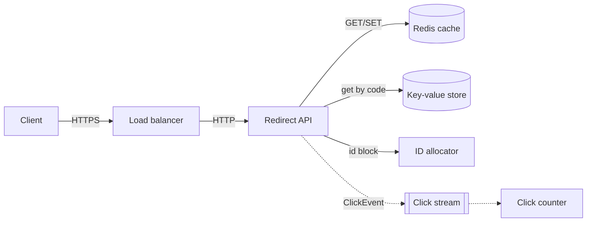

# URL shortener - design

Status: reviewed · Date: 2026-11-17 · Owner: platform team

## Summary
A link shortener for 100M new links a month and about 100 redirects per link created. Redirects
are served from a Redis cache in front of a partitioned key-value store; codes come from
blocks of ids handed out by a small allocator and encoded in base 62. The main trade-off is a
302 redirect (every click reaches us, so analytics and takedowns work) over a 301 (cheaper,
but browsers cache it forever).

## Requirements
### Functional requirements
- Create a short link for a long URL; redirect a short code to its long URL.
- Count clicks per link (minutes late is fine).

### Non-functional requirements
- p99 redirect latency under 50 ms at the edge of our network (given).
- Availability 99.95% for redirects; 99.9% for link creation (assumed).
- Durability: no link is ever lost once created; RPO 0 for links, RTO 30 min (assumed).

### Non-goals
- Custom vanity domains, link editing after creation, user accounts.

## Estimation
`python3 scripts/capacity_calc.py --writes-per-day 3.3e6 --reads-per-day 3.3e8 --write-bytes 500 --read-bytes 500 --db-ms 2 --years 5 --assumed write-bytes,peak --scale 10,100 --out url-shortener.calc.json`

- Writes 3.3M/day (given: 100M/month), reads 330M/day (given: 100x). Peak multiplier 3 (assumed).
- Peak redirects about 11,458/s; peak creates about 115/s.
- Storage 2.7 TiB logical over 5 years, 8.2 TiB with 3 replicas.
- Hot set upper bound about 31 GiB: fits one Redis node with a replica.
- Without a cache the store would see 11,458 reads/s and hold about 23 busy connections at 2 ms.

## Architecture

Stateless API servers behind an L7 load balancer. Reads check Redis first, then the key-value
store. Creates take the next id from a locally held block of 1,000 ids.

## API and data model
- `POST /links {url}` with an `Idempotency-Key` header returns `{code}`.
- `GET /{code}` returns 302 to the long URL, or 404 (cached as a negative entry for 30 s).
- Table `links(code PK, long_url, created_at)`, partitioned by hash of code.

## Deep dives
### Code generation
Ids come from an allocator in blocks of 1,000, are scrambled with a keyed permutation and
encoded in base 62 (7 characters). No collision checks; codes are not enumerable.

### Read path
Redis cache-aside with a 24 h TTL and negative caching; a miss reads one partition.

## Consistency and failure modes
- A new link is readable within 1 s; a click count can lag by up to 5 min.
- Cascade: Redis node lost -> all 11,458 reads/s hit the store -> connection pool 23 -> 100% busy -> timeouts -> client retries x3 -> 4x load. Defence: request coalescing per code, a 200 ms store timeout, retry budget 10%, and a warm replica promoted within 30 s.
- DR: store replicated across 3 zones; RPO 0 for links, RTO 30 min from snapshots.

## Security, operations and cost
Rate limit 10 creates/min per IP; destination safety check on create; alert on 404 rate > 20%.

## Trade-offs

| Decision | Solves | Worsens | Change it when |
|---|---|---|---|
| Redis cache-aside in front of the store | 90% of redirects never reach the store; p99 under 50 ms | stale target for up to 24 h after a takedown | hit ratio < 80% for 1 h, or takedowns > 5/day |
| Partitioned key-value store keyed by code | 8.2 TiB spread evenly; one partition per redirect | no range scans by date | a partition > 40% of total store reads for 1 h |
| 302 redirect instead of 301 | every click is counted; takedowns work | every click costs a request | redirect egress cost > $2,000/month |
| Id blocks from an allocator, base 62 | no collision checks | allocator is a dependency for creates | creates fail > 0.1% for 5 min |

## Evolution
- 10x (114,583 reads/s peak): a Redis cluster of 3 shards; the store gains partitions.
- 100x: regional read replicas and per-region caches; migrate with dual reads.

## Open questions
- Is a 24 h staleness window after a takedown acceptable to trust and safety? (assumed yes)

## Review log
- Reviewer: cascade on cache loss was missing - accepted, added coalescing and timeout.
- agy: skipped (fixture).
